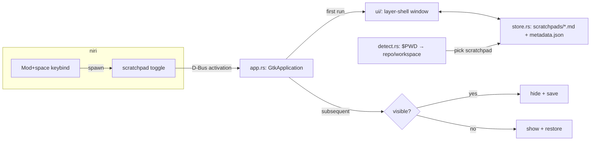
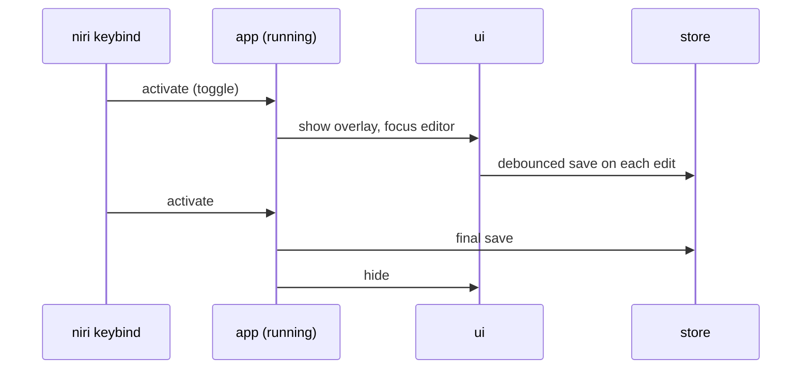

# Scratchpad — Design

Product contract lives in [docs/specs.md](docs/specs.md); this file is the
architecture that satisfies it.

## Constraints driving the design

| Constraint | Consequence |
|---|---|
| Wayland + niri | No global keygrab, no X11 calls — compositor spawns `scratchpad toggle` |
| Open < 150 ms | Single instance stays resident; "open" = show existing window, not cold start |
| Never lose content | Autosave on debounce + on hide/quit; files, not a DB |
| Local only | `$XDG_DATA_HOME` + plain `.md` files |

## Components

### `app.rs` — lifecycle & IPC

- `GtkApplication` with `ApplicationId` gives single-instance for free: a second
  `scratchpad toggle` invocation activates the running one.
- Toggle logic in the `activate` handler: visible → save + hide; hidden → detect
  association, load, show.

### `ui/` — overlay window

- `gtk4-layer-shell` anchors a small floating layer-surface overlay on `TOP`
  layer; libadwaita follows the desktop dark preference.
- Markdown edit + preview (TextView-based; no WebKit — weight and a dependency
  the spec doesn't need).
- Quick actions (snippet/TODO/URL/command insertion, copy-all) are buttons wired
  to `store`, not GTK internals.

### `store.rs` — persistence

- One `.md` per scratchpad under `$XDG_DATA_HOME/scratchpad/scratchpads/` —
  files are authoritative; `metadata.json` only indexes id →
  `{name, repo_path, workspace, timestamps}` for `list` and association.
- Save triggers: debounced on edit (~500 ms), on hide, on quit. Writes are
  write-temp-then-rename so a crash can't truncate a note.
- `export <id> <path>` copies the `.md` verbatim.

### `detect.rs` — association

- Walk ancestors of `$PWD` for `.git` → repo-root hash keys the scratchpad;
  no repo → `default.md`. Workspace tagging optional later (YAGNI until niri
  workspace mapping is needed).

## Data flow — capture

## Failure & edge cases

- Second `scratchpad` binary invocation: forwards via D-Bus, exits — never two windows.
- Crash mid-write: atomic rename means the file is old-or-new, never torn.
- `metadata.json` missing/corrupt: rebuilt from scanning `scratchpads/*.md` (filenames embed ids).
- `$PWD` deleted between invocations: detect falls back to `default`.

## Non-goals (do not add)

Cloud sync, network of any kind, database, full markdown-editor features, rich
note organization.

## Success criteria → where it's enforced

- < 150 ms open → resident instance; show path does no file I/O beyond the active note
- Never lose content → debounce + hide + quit saves, atomic writes
- Multiple scratchpads, low friction → automatic repo association, `scratchpad list`
- Fedora/Niri/Wayland clean → layer-shell + portal theming, compositor-owned keybind
